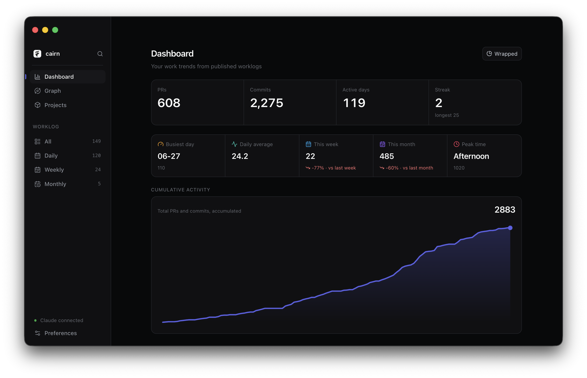
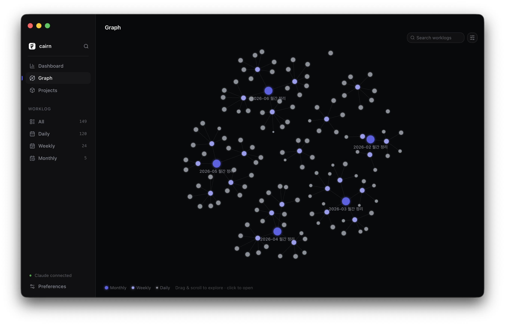
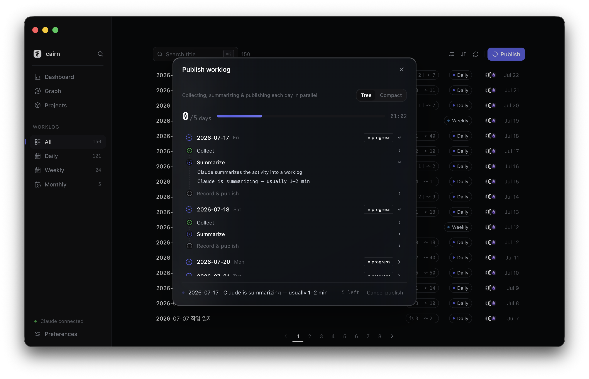

# cairn

[English](README.md) · [한국어](README.ko.md)

> Like a trail cairn, stack one mark of work each day — and leave a path behind.

cairn turns your GitHub PRs and commits across multiple repos and accounts into an AI-summarized worklog (Claude or Codex), recorded as local Markdown with automatic weekly and monthly rollups. Connect integrations like Notion to publish it further.

It runs as an **Electron desktop app** on top of a headless engine. Everything stays on your machine: it summarizes through the CLI you're already signed in to — Claude (Agent SDK) or OpenAI Codex — and never sends source code or diffs to external services.



## Highlights

- **Aggregate** — GitHub PRs (authored + assigned) and commits across multiple repositories and accounts. Local Git collection is an optional source (off by default — for repos not on GitHub)
- **Summarize** — your choice of engine writes the worklog in your language (Korean or English), reading each PR body to capture what the work was, as concise number- and tech-oriented bullets
  - **Claude** (Claude Code login, Agent SDK) or **Codex** (Codex CLI with a ChatGPT login) — pick the engine and model in Preferences, and sign in again from the app when a login expires
  - The engine runs with every tool disabled, so it only sees the activity text cairn hands it
- **Record** — daily logs + automatic weekly/monthly rollups, written to a local Markdown journal (frontmatter + wiki links)
- **Projects view** — a per-repo timeline of the last year; click a repo to see what you shipped in that window
- **Integrations** — optionally publish each entry to Notion, mirror the journal into any Markdown folder (e.g. an Obsidian vault), or auto-back-up the journal folder with Git
- **Desktop app** — guided first-run setup, one-click publish, opt-in auto-publish at a time you choose (your local timezone), in-app worklog viewer, a stats dashboard, an interactive worklog graph, publish snapshots with diff restore, dark/light/system themes, ko/en
- **Local-first & private** — machine-local secrets, no server, no code-body egress (ADR 0003)

Daily, weekly, and monthly entries link into one connected graph via wiki links:



Missed some past dates? Backfill collects, summarizes, and publishes them per day in one pass:



## Requirements

- macOS
- One summary engine:
  - Claude — Claude Code signed in with a Pro/Max subscription (or an Anthropic API key)
  - Codex — [Codex CLI](https://github.com/openai/codex) signed in with a ChatGPT plan
- GitHub fine-grained PAT (read-only)

Optional: a Notion internal integration token, if you want entries published to Notion as well. To also collect local repos that aren't on GitHub, enable local Git collection in the Connections tab (off by default).

The desktop app's first-run setup walks you through connecting these and writes the config for you.

## Download

### From the terminal (simplest)

Paste this into Terminal — it downloads the latest release into Applications and launches it. Run the same line again to update.

```sh
curl -fL https://github.com/ldhbenecia/cairn/releases/latest/download/Cairn-arm64-mac.zip -o /tmp/Cairn.zip && { pkill -x Cairn; sleep 2; pkill -9 -x Cairn; ditto -x -k /tmp/Cairn.zip /Applications && open /Applications/Cairn.app; }
```

Files fetched with `curl` don't get the quarantine flag that triggers the "unidentified developer" warning, so the app opens right away — which also means that check is skipped, so only do this with a source you trust. If you get a permission error on `/Applications`, replace both `/Applications` with `~/Applications` (create it with `mkdir -p ~/Applications` if missing).

### From the `.dmg`

Grab the latest `.dmg` from the [Releases page](https://github.com/ldhbenecia/cairn/releases/latest).

- **macOS (Apple Silicon / arm64)** for now. Intel and other platforms may follow.
- The app is **not yet code-signed** (no paid Apple Developer ID), so macOS Gatekeeper blocks it on first launch. After dragging it to Applications, clear the quarantine flag once:

  ```sh
  xattr -cr /Applications/Cairn.app
  ```

  then open it normally. (Alternatively, on macOS Sequoia/Tahoe: **System Settings → Privacy & Security → Open Anyway**.)
- It checks for new versions and notifies you when one is available — download the new `.dmg` to update. (Seamless auto-update will come once the app is signed.)

## Build & run from source

Prefer building it yourself? You can.

- Node 24 LTS (see [.nvmrc](.nvmrc)), pnpm 10+

```bash
git clone https://github.com/ldhbenecia/cairn.git
cd cairn
nvm use
pnpm install

pnpm --filter @cairn/desktop dev   # run the desktop app (dev)
```

Headless engine only (CLI):

```bash
pnpm build
node packages/core/dist/main.js --mode=daily --date=$(date +%F) --dry-run
```

Modes: `daily`, `weekly`, `monthly`. Manual setup of `.env` + `worklog.config.json` is documented in [docs/SETUP.md](docs/SETUP.md) ([한국어](docs/SETUP.ko.md)) — though the desktop app generates both.

> The `launchd` jobs under [ops/](ops/) are **deprecated** — auto-publish is owned by the desktop app (ADR 0015). They remain only for headless/CLI-only setups.

## Architecture

pnpm monorepo:

- `packages/core` — headless engine (collectors → Claude/Codex summarizer → Notion publisher), runnable as a CLI
- `packages/desktop` — Electron app (setup wizard, manual/auto publishing, in-app log viewer, stats dashboard, preferences)
- `packages/web` — marketing site (Next.js, deployed on Vercel); also hosts the optional cross-device sync backend (auth + stats API)

### Tech stack

- **Engine** (`packages/core`) — TypeScript · NestJS (standalone) · Octokit · Notion SDK · Claude Agent SDK · Codex CLI
- **Desktop** (`packages/desktop`) — Electron · React 19 · Tailwind CSS v4 · electron-vite · electron-updater
- **Web** (`packages/web`) — Next.js · Tailwind CSS v4 · Better Auth + Drizzle ORM + Postgres (cross-device sync)
- **Tooling** — pnpm workspaces · ESLint/Prettier · Husky + lint-staged · GitHub Actions

## Documentation

| Path | Contents |
|------|----------|
| [docs/SETUP.md](docs/SETUP.md) ([한국어](docs/SETUP.ko.md)) | Manual setup guide |
| [CLAUDE.md](CLAUDE.md) / [AGENTS.md](AGENTS.md) | Working context for Claude Code / Codex |
| [.claude/rules/](.claude/rules/) | Project rules |

## Privacy

Your worklogs, code, and tokens stay on your machine. Worklogs are plain Markdown files on disk; data is only sent to the services you choose to connect (GitHub, your summary engine — Claude or Codex, Notion) — never anywhere else.

cairn sends **anonymous usage telemetry** (PostHog) to understand how many people use it and which versions are active. It is enabled by default and can be turned off in **Preferences → About → Anonymous usage stats**.

- **Sent**: a random anonymous install id, app version, OS/arch, and event names (`app_launched`, `publish` with mode + outcome).
- **Never sent**: worklog content, PR titles, repo names, commit messages, file paths, tokens, or any personal information.

## License

[AGPL-3.0-or-later](LICENSE). Copyright (C) 2026 Donghyeok Lim.

Source code is public for reference and forks. Any derivative work — including
modifications and any service that exposes this software over a network — must
also be licensed under AGPL-3.0-or-later and provide its full source to users.
